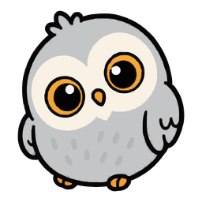

  

<h1 align="center">nensi5.github.io</h1>

  My personal corner of the internet — systems, security &amp; cloud.
    
  <a href="https://nensi5.github.io"><b>✦ Visit the site ✦</b></a>

  
  
  

---

No frameworks, no build step: just HTML, CSS and a little JavaScript.
The owl is **Gufetto**, mascot of my [SOC triage assistant](https://github.com/Nensi5/gufetto).

Made with ♡ in Belgrade

